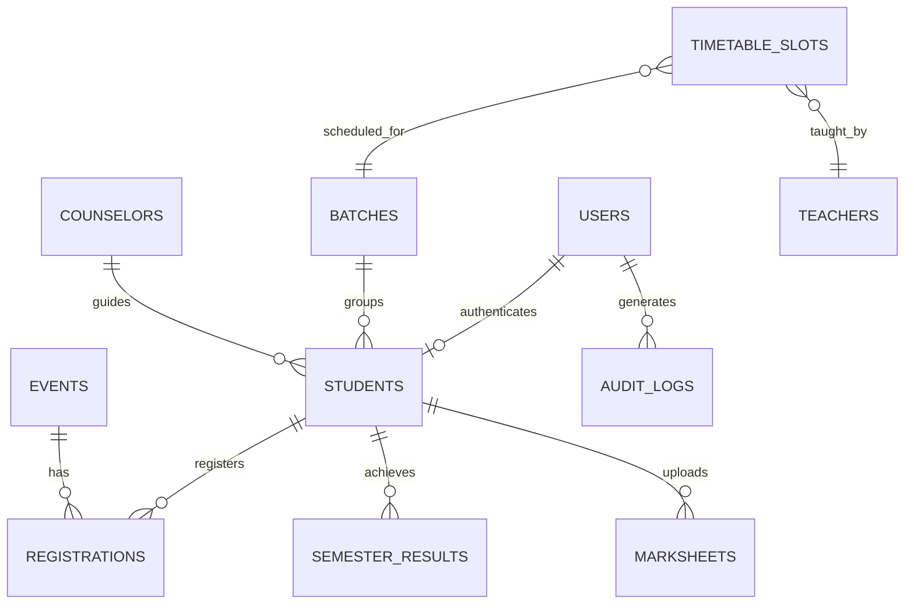

# 🎓 StudentHub — Campus Information & Student Management Portal

<div align="center">

[-4f46e5.svg?style=for-the-badge&logo=github)](https://github.com/25aiml019-hub)
[](https://charusat.ac.in)
[](https://charusat.ac.in)
[](https://anshika.infinityfree.me/WT_project/)
[-brightgreen.svg?style=for-the-badge&logo=python)](#-automated-testing--verification-suites)

<p align="center">
  <strong>A full-stack, enterprise-grade, responsive campus intranet and student information management system.</strong><br>
  Built from foundational HTML5/CSS3 to advanced modular PHP 8.2+, MySQL 8.0, REST APIs, Session Security, and automated test pipelines.
</p>

[🌐 Live Production Website](https://anshika.infinityfree.me/WT_project/) • [📋 System Architecture](#-system-architecture) • [🛠️ Tech Stack](#️-technologies-used) • [📚 Syllabus Coverage](#-practical-syllabus-mapping-practicals-115) • [🧪 Test Suites](#-automated-testing--verification-suites)

</div>

---

## 👤 Author & Project Metadata

| Item | Details |
|---|---|
| **Author / Developer** | **Daksh Harkhani** |
| **Student ID** | **25AIML019** |
| **Department** | Artificial Intelligence & Machine Learning (AIML) |
| **Institution** | Chandubhai S. Patel Institute of Technology (CSPIT) |
| **University** | Charotar University of Science and Technology (CHARUSAT) |
| **Academic Term** | B.Tech Semester 3 (Academic Year 2025–2026) |
| **Subject / Lab** | **AIUE203: Web Development Fundamentals (WDF)** |
| **Email** | [dakshharkhani18@gmail.com](mailto:dakshharkhani18@gmail.com) |
| **GitHub Profile** | [@25aiml019-hub](https://github.com/25aiml019-hub) |
| **Live Deployed URL** | [https://anshika.infinityfree.me/WT_project/](https://anshika.infinityfree.me/WT_project/) |

---

## 🌐 Live Production Deployment (InfinityFree)

StudentHub is fully deployed and accessible publicly on InfinityFree's Apache & FastCGI production infrastructure.

- **Public Production URL:** [https://anshika.infinityfree.me/WT_project/](https://anshika.infinityfree.me/WT_project/)
- **Public Entry Point:** `public/` directory with automatic root-level rewrites.
- **Database Engine:** MySQL 8.0 / MariaDB on remote host `sql301.infinityfree.com` (21 relational tables, 830+ records).

### 🔑 Demo Evaluation Credentials

You can test and evaluate the system immediately using any of the pre-configured accounts:

| Portal | Role | Username / ID | Password | Access Capabilities |
|---|---|---|---|---|
| **Admin Portal** | Administrator | `admin` | `admin123` | Full student CRUD, event management, poster upload, CSV exports, audit log viewing. |
| **Student Portal** | Lead Student (Author) | `25AIML019` | `student123` | Personal profile, Sem 1 & 2 SGPA, Sem 3 Timetable, marksheet upload, OCR analysis. |
| **Student Portal** | Roster Accounts | `25AIML001` through `25AIML078` | `student123` | Individual student logins for all 78 registered AIML students. |

---

## 🌟 Key Features & Capabilities

### 1. 🏛️ Public Campus Portal & Life
- **Hero Showcase & Brand Identity:** Adelaide-inspired clean aesthetic, deep navy (`#1e293b`), crisp slate, and warm amber accents.
- **Campus Life & Student Clubs:** Dedicated interactive pages for university clubs including Coding Club, Music Society, Photography Club, and Sports Association.
- **Administrative Hub:** Office hours, fee counter schedules, scholarship notifications, and exam registration desk timings.
- **Collapsible FAQ:** Dynamic accordion interface with client-side state toggling and a persistent Light/Dark theme switcher backed by browser `localStorage`.
- **Contact Desk:** Interactive message form with client-side validation and concurrency-safe (`flock`) persistent server-side file logging.

### 2. 📅 Campus Events Management
- **Dynamic Events Feed:** Asynchronous data fetching rendering live campus events.
- **Multi-Criteria Filtering:** Instant filtering by event category (Technical, Cultural, Sports, Academic) and scheduling status.
- **Event Registrations:** Integrated student registration system tracking attendance and seat quotas.
- **Admin Event CRUD:** Administrative form for scheduling new events, updating dates, setting registration deadlines, and uploading promotional posters.

### 3. 👥 Official 78-Student Class Directory
- **Source of Truth Dataset:** 100% accurate representation of all 78 AIML undergraduate students (`25AIML001` to `25AIML078`) compiled from canonical academic rosters (`database/roster_data.json`).
- **Instant Search:** Multi-attribute real-time filtering by Student Name, Roll Number, or Email with zero external UI libraries.
- **Batch & Counselor Filtering:** Categorization by practical batches (`AIML-1`, `AIML-2`, `AIML-3`, `AIML-4`) and faculty counselor assignments.
- **Fast Client-Side Pagination:** Smooth navigation with customizable page sizes, page boundary protection, and total record indicators.

### 4. 📊 Academic Records & Semester 3 Timetable
- **SGPA & CGPA Analytics:** Integrated semester 1 and semester 2 performance records (156 academic results) with automated cumulative grade point average (CGPA) calculations.
- **Official Semester 3 Timetable:** Weekly timetable schedules with 51 official time slots detailing course codes, lecture halls, lab batches, and faculty teachers.
- **Interactive Marksheet Upload & Tesseract OCR:**
  - Secure marksheet image upload with strict MIME type sniffing, extension whitelisting, and file size quotas.
  - OCR integration extracting semester grades and SGPA directly from student marksheets.

### 5. 🛡️ Enterprise Security & Hardening
- **Authentication:** Dual-portal access with Bcrypt password hashing (`PASSWORD_BCRYPT`, cost 12).
- **CSRF Defense:** Cryptographically secure token generation (`random_bytes(32)`) and timing-safe verification (`hash_equals()`).
- **Session Hardening:** Session regeneration (`session_regenerate_id(true)`) upon privilege change, strict inactivity timeouts, and `HttpOnly` / `SameSite=Lax` cookie flags.
- **SQL Injection Prevention:** 100% parameterized queries via PDO singleton and MySQLi prepared statements.
- **CSV Formula Injection Defense:** Sanitization of spreadsheet exports by escaping leading symbols (`=`, `+`, `-`, `@`) with tab prefixes.
- **Upload Protection:** Apache `.htaccess` script execution traps (`RemoveHandler`, `php_flag engine off`) in upload directories.
- **System Audit Logging:** Comprehensive administrative and authentication audit trail logging actions, user IDs, timestamps, and IP addresses.

---

## 🛠️ Technologies Used

```
┌────────────────────────────────────────────────────────────────────────┐
│                               STUDENTHUB                               │
├──────────────────┬───────────────────┬─────────────────────────────────┤
│    FRONTEND      │     BACKEND       │     DATABASE & ENVIRONMENT      │
├──────────────────┼───────────────────┼─────────────────────────────────┤
│ • HTML5 Semantic │ • PHP 8.2+ Modular│ • MySQL 8.0 / MariaDB 10.11     │
│ • CSS3 Variables │ • PDO (Singleton) │ • 21 Relational Tables (InnoDB) │
│ • Flexbox & Grid │ • MySQLi Prepared │ • Foreign Keys & Cascades       │
│ • Vanilla JS ES6+│ • Session Guard   │ • Apache 2.4 + FastCGI          │
│ • Fetch API AJAX │ • RESTful JSON API│ • Tesseract OCR Integration     │
│ • LocalStorage   │ • Bcrypt / CSRF   │ • Python 3.10+ Automated Tests  │
└──────────────────┴───────────────────┴─────────────────────────────────┘
```

---

## 📁 System Architecture

StudentHub adopts a **Feature-Based Tiered Architecture**, cleanly separating public assets from server-side controllers, private business services, and database storage:

```
WT_project/
│
├── public/                                # Public DocumentRoot (Web-accessible)
│   ├── .htaccess                          # Asset access rules & MIME handling
│   ├── index.html                         # Static entry point (Practicals 1–5)
│   ├── index.php                          # Dynamic PHP entry point (uses app/includes)
│   ├── pages/                             # Semantic presentation pages
│   │   ├── about.html                     # About Us & developer profile
│   │   ├── administrative.html            # Campus services & timings
│   │   ├── campuslife.html                # Campus life & student clubs hub
│   │   ├── course-enrollment.html         # Course catalog & faculty listings
│   │   ├── dashboard.html                 # Student dashboard & class directory
│   │   ├── events.html                    # Campus events schedule & filters
│   │   ├── login.html / login.php         # Student & admin login portal
│   │   ├── registration.html / .php       # User registration forms
│   │   ├── contact.html / contact.php     # Contact desk & feedback form
│   │   ├── faq.html                       # Collapsible FAQ & theme switcher
│   │   └── clubs/                         # Individual club portals (coding, sports, etc.)
│   │
│   ├── assets/                            # Static web assets
│   │   ├── css/                           # Main design tokens & module stylesheets
│   │   ├── js/                            # Modular ES6+ frontend scripts
│   │   ├── images/                        # Brand identity vector & image assets
│   │   └── data/                          # Canonical JSON datasets (students, events, faqs)
│   │
│   ├── admin/                             # Administrative portal controllers
│   │   ├── index.php                      # Admin backoffice dashboard
│   │   ├── students.php                   # Student CRUD management interface
│   │   └── events.php                     # Campus event management interface
│   │
│   ├── student/                           # Student self-service portal controllers
│   │   └── index.php                      # Student personal dashboard, SGPA & timetable
│   │
│   ├── api/                               # RESTful JSON API endpoints
│   │   ├── auth/                          # Login, logout, session check APIs
│   │   ├── students/                      # Student directory & export APIs
│   │   ├── events/                        # Event feed & registration APIs
│   │   ├── courses/                       # Course enrollment APIs
│   │   └── marksheets/                    # Marksheet upload & OCR verification APIs
│   │
│   ├── process-login.php                  # Authentication handler & session initiator
│   ├── process-logout.php                 # Safe session destruction & cookie invalidator
│   ├── process-registration.php           # Transactional registration processor
│   ├── process-contact.php                # Contact form submission processor
│   ├── csrf-token.php                     # Secure CSRF token endpoint
│   └── serve-poster.php                   # Secure image delivery with path traversal defense
│
├── app/                                   # Application Core (Restricted Access)
│   ├── config/                            # Environment config, PDO/MySQLi connections, security
│   ├── includes/                          # Reusable partials (header.php, nav.php, footer.php)
│   ├── middleware/                        # RBAC role guards & authentication middleware
│   └── services/                          # Business logic layer (Student, Event, Course, Timetable)
│
├── database/                              # Complete Database Layer & Migrations
│   ├── production_complete_migration.sql  # Canonical 21-table production database migration
│   ├── roster_data.json                   # Canonical source of truth for all 78 AIML students
│   ├── schema.sql                         # Base schema definitions
│   ├── seed.sql                           # Seed data records
│   ├── verify_clean_import.py             # Database import validation test
│   ├── build_production_bundle.py         # Deployment bundler for Apache/cPanel
│   └── build_infinityfree_bundle.py       # Deployment bundler for InfinityFree FastCGI
│
├── storage/                               # Protected Writable Application Storage
│   ├── data/                              # Concurrency-safe CSV and JSON stores (.htaccess protected)
│   ├── logs/                              # Application execution and error logs
│   └── uploads/                           # Marksheet and poster uploads (.htaccess protected)
│       ├── marksheets/                    # Student uploaded marksheets (script execution disabled)
│       └── posters/                       # Event promotional banners
│
├── tests/                                 # Automated Test Runners & Verification Suites
│   ├── run_all_tests.py                   # Master test orchestrator (runs all 10 suites)
│   ├── verify_project.py                  # HTML5/CSS3 assets & relative link integrity
│   ├── verify_practical_6.py              # Fetch API, search/filter logic, DOM safety
│   ├── verify_phase_3.py                  # PHP processing, CSRF, database connectivity
│   ├── verify_phase_4.py                  # Transactions, login, session fixation, RBAC
│   ├── verify_phase_5.py                  # Student & Event CRUD, poster upload, CSV safety
│   ├── verify_ui_ux.py                    # UI/UX design tokens & visual hierarchy
│   ├── verify_product_redesign.py         # Timetable, SGPA calculation, marksheet OCR
│   ├── verify_phase_remedy.py             # Form handling & error state remedies
│   ├── verify_responsive_layout.py        # Mobile/tablet responsive breakpoints
│   └── verify_marksheet_and_event_fixes.py# Marksheet storage & event registration fixes
│
├── docs/                                  # Technical Documentation & Practical Audit Reports
│   ├── INFINITYFREE_DEPLOYMENT_GUIDE.md   # Step-by-step InfinityFree deployment guide
│   ├── PRODUCTION_DEPLOYMENT_GUIDE.md     # Production deployment & disaster recovery guide
│   ├── PROJECT_AUDIT.md                   # Initial codebase audit & refactoring log
│   └── practical-*-test-report.md         # Dedicated test reports for Practicals 1 to 12
│
├── .gitignore                             # Version control exclusion rules
├── .htaccess                              # Root Apache routing & security configuration
├── .env.example                           # Development environment configuration template
├── .env.infinityfree.example              # InfinityFree production environment template
├── .env.production.example                # Standard production environment template
├── PROJECT_STRUCTURE.md                   # Architectural specification document
└── README.md                              # Comprehensive repository documentation
```

---

## 📚 Practical Syllabus Mapping (Practicals 1–15)

Every practical requirement from the curriculum is thoroughly implemented, documented, and backed by automated tests:

| Practical | Syllabus Requirement | StudentHub Implementation | Primary Files |
|---|---|---|---|
| **Practical 1** | Problem definition, user personas, wireframes, sitemap, and repository setup. | Clean tiered repository architecture, sitemap, and architectural specifications. | `PROJECT_STRUCTURE.md`, `docs/PROJECT_AUDIT.md` |
| **Practical 2** | Semantic HTML5 structure with accessibility and SEO readiness. | All 10 subpages structured with semantic elements (`<header>`, `<nav>`, `<main>`, `<section>`, `<table>`, `<form>`, `<footer>`). | `public/pages/*.html` |
| **Practical 3** | Responsive UI design using modern CSS Grid and Flexbox layouts. | Centralized CSS tokens (`:root`), mobile-first media queries, flexible card grids, and responsive tables. | `public/assets/css/*.css` |
| **Practical 4** | JavaScript DOM manipulation, events, and dynamic UI state. | Interactive collapsible FAQ accordion, Light/Dark theme switcher with `localStorage` persistence. | `public/assets/js/faq.js` |
| **Practical 5** | Client-side form validation with regular expressions. | Real-time regex validation for student registration (10-digit phone, email format, password criteria). | `public/assets/js/registration.js` |
| **Practical 6** | Asynchronous data rendering via Fetch API with search, filter, and pagination. | Dynamic rendering of `students.json`, `events.json`, and `faqs.json` with multi-filter search, sorting, and pagination. | `public/assets/js/*-renderer.js` |
| **Practical 7** | PHP form processing, CSRF protection, and concurrency-safe file storage. | POST enforcement, timing-safe CSRF tokens (`app/config/security.php`), Bcrypt hashing, and `flock()` CSV/JSON storage. | `public/process-contact.php`, `storage/data/` |
| **Practical 8** | Relational MySQL database connectivity, schema, and prepared statements. | Singleton PDO and MySQLi connections (`app/config/db.php`), relational schema with 6+ InnoDB tables and foreign key cascades. | `app/config/db.php`, `database/schema.sql` |
| **Practical 9** | Secure user registration with multi-table transactions. | Multi-table atomic transactions (`users` + `students`), duplicate email/username rejection, and Bcrypt hashing. | `public/process-registration.php` |
| **Practical 10** | Login, logout, session management, and Role-Based Access Control (RBAC). | Prepared statement authentication, `session_regenerate_id(true)`, inactivity timeouts, logout invalidation, and role guards. | `public/process-login.php`, `app/includes/auth_check.php` |
| **Practical 11** | Administrative Student Management CRUD with search, filter, and CSV export. | Admin student dashboard, department/year filtering, pagination, soft deactivation, audit logs, and injection-safe CSV export. | `admin/students.php`, `api/students/` |
| **Practical 12** | Event Management CRUD with secure poster file upload validation. | Admin event creation/editing, MIME sniffing, image dimension checking, script scanning, and secure delivery via `serve-poster.php`. | `admin/events.php`, `public/serve-poster.php` |
| **Practical 13** | RESTful PHP JSON APIs with asynchronous Fetch CRUD. | Resource-based REST API endpoints returning structured JSON responses with HTTP status codes. | `public/api/auth/`, `public/api/students/` |
| **Practical 14** | Admin dashboard with dynamic navigation, analytics, and audit logging. | Dedicated administrative portal (`admin/index.php`) with real-time stats, security alerts, and system audit trails. | `admin/index.php`, `app/services/audit_service.php` |
| **Practical 15** | Final integration, end-to-end testing, documentation, and production deployment. | Full project integration, 10 automated test suites (100% pass rate), and live InfinityFree production deployment. | `tests/run_all_tests.py`, `database/production_complete_migration.sql` |

---

## 🗄️ Database Architecture & Migrations

The StudentHub database is built on **MySQL 8.0 / MariaDB** and comprises **21 relational InnoDB tables** maintaining strict relational integrity:



### Table Inventory

| # | Table Name | Purpose | Record Count |
|---|---|---|---|
| 1 | `users` | User authentication records with Bcrypt hashed passwords and roles (`admin`, `student`) | 82 |
| 2 | `students` | Student profiles including roll numbers, names, batches, departments, and counselors | 100 (78 AIML) |
| 3 | `events` | Campus events with category, venue, dates, time, and poster paths | 16 |
| 4 | `registrations` | Student event registrations with timestamps and statuses | 5 |
| 5 | `semester_results` | Official Sem 1 and Sem 2 academic records with SGPA | 156 |
| 6 | `timetable_slots` | Semester 3 AIML weekly timetable slots across batches | 51 |
| 7 | `marksheets` | Marksheet uploads with OCR extracted grades and verification flags | 32 |
| 8 | `batches` | Academic batches (`AIML-1`, `AIML-2`, `AIML-3`, `AIML-4`) | 4 |
| 9 | `counselors` | Faculty academic counselors and advisory groups | 4 |
| 10 | `teachers` | Teaching faculty listings and departments | 5 |
| 11 | `subjects` | Course subjects and academic credit definitions | 6 |
| 12 | `teacher_assignments` | Teacher-to-subject allocation mappings | 5 |
| 13 | `courses` | Available elective and core courses | 6 |
| 14 | `course_enrollments` | Student course enrollment records | 6 |
| 15 | `timetable` | Master timetable definitions | 5 |
| 16 | `announcements` | Campus-wide notices and broadcast messages | 3 |
| 17 | `audit_logs` | Comprehensive security and administrative audit trail | 450+ |
| 18 | `clubs` | University student club records | 4 |
| 19 | `club_memberships` | Student club membership enrollments | 0 |
| 20 | `contact_messages` | Inbound inquiries submitted through the contact desk | 2 |
| 21 | `unassigned_academic_records` | Unassigned / archival academic records | 13 |

### 🚀 One-Command Migration Verification

The database migration is completely automated and verified:

```bash
# Run the automated clean-database import verification
python database/verify_clean_import.py
```

*Verification output:*
```
Created clean database: studenthub_clean_verify
Exported fresh production database dump to database/production_complete_migration.sql
Import succeeded into clean database without errors!
All 21 tables match exactly between original and clean import.
[PASS] 78 AIML student records verified.
[PASS] 16 Campus events verified.
[PASS] 156 Semester results verified.
[PASS] 51 Timetable slots verified.
[PASS] Admin user account verified.
VERIFICATION COMPLETE: Clean database migration is 100% verified, lossless, and ready for production deployment.
```

---

## 🧪 Automated Testing & Verification Suites

StudentHub includes **10 comprehensive test suites** covering all aspects of the application. All suites are run in sequence via the master test orchestrator:

```bash
python tests/run_all_tests.py
```

### Test Suite Summary

```
======================================================================
RUNNING ALL 10 TEST SUITES (PRACTICALS 1-12, REMEDY, LAYOUT & FIXES)
======================================================================
[PASS] tests/verify_project.py                     (HTML5/CSS3 assets, links & regex validation)
[PASS] tests/verify_practical_6.py                 (JSON datasets, search, filter, sort & pagination)
[PASS] tests/verify_phase_3.py                     (PHP processing, CSRF, flock storage, PDO connectivity)
[PASS] tests/verify_phase_4.py                     (Transactions, login, session fixation, RBAC guards)
[PASS] tests/verify_phase_5.py                     (Student & Event CRUD, poster upload, CSV safety)
[PASS] tests/verify_ui_ux.py                       (CSS design tokens, responsive cards, glassmorphism)
[PASS] tests/verify_product_redesign.py            (Semester 3 Timetable, SGPA records, Marksheet OCR)
[PASS] tests/verify_phase_remedy.py                (Form handling, error states, sanitization)
[PASS] tests/verify_responsive_layout.py           (Mobile/tablet responsive breakpoints)
[PASS] tests/verify_marksheet_and_event_fixes.py   (Marksheet file uploads, event registrations)
======================================================================
ALL 10 TEST SUITES PASSED (100% SUCCESS)!
```

---

## 💻 Local Installation & Setup Guide

### Option 1: Quick Static Preview (Zero Dependencies)
For evaluating static HTML5/CSS3 and client-side JavaScript (Practicals 1–5):
```bash
# Clone the repository
git clone https://github.com/25aiml019-hub/<repo-name>.git
cd WT_project

# Launch a lightweight local server
python -m http.server 8000
```
Open your browser at `http://localhost:8000/public/index.html`.

---

### Option 2: Full-Stack Setup with XAMPP (Apache + PHP + MySQL)

1. **Clone into XAMPP Web Root:**
   ```bash
   cd C:\xampp\htdocs
   git clone https://github.com/25aiml019-hub/<repo-name>.git WT_project
   cd WT_project
   ```

2. **Start Services:**
   Open the **XAMPP Control Panel** and start **Apache** and **MySQL**.

3. **Import Database:**
   Open **phpMyAdmin** (`http://localhost/phpmyadmin/`) or run via command line:
   ```bash
   mysql -u root -e "CREATE DATABASE studenthub CHARACTER SET utf8mb4 COLLATE utf8mb4_unicode_ci;"
   mysql -u root studenthub < database/production_complete_migration.sql
   ```

4. **Configure Environment:**
   Create `.env` by copying the development example:
   ```bash
   cp .env.example .env
   ```
   Verify database credentials in `.env`:
   ```ini
   APP_ENV=local
   APP_DEBUG=true
   APP_URL="http://localhost/WT_project"
   
   DB_HOST="127.0.0.1"
   DB_PORT=3306
   DB_NAME="studenthub"
   DB_USER="root"
   DB_PASS=""
   ```

5. **Access Application:**
   Open your browser and navigate to:
   - **Public Website:** `http://localhost/WT_project/public/`
   - **Student Login:** `http://localhost/WT_project/public/pages/login.html`
   - **Admin Portal:** `http://localhost/WT_project/public/admin/`

---

### Option 3: PHP Built-in Server
```bash
cd WT_project
php -S localhost:8000 -t public
```
Visit `http://localhost:8000` in your web browser.

---

## 📦 Production Deployment Packaging

StudentHub includes automated bundling scripts that generate complete, production-ready ZIP archives tailored for deployment:

```bash
# Build complete production archive
python database/build_production_bundle.py

# Build InfinityFree FastCGI-optimized archive
python database/build_infinityfree_bundle.py
```

The bundler packages the complete application, configures `.htaccess` rewrite rules, initializes storage anchors, and bundles the canonical database migration.

---

## 🚀 Pushing to GitHub

To push this repository to your personal GitHub account, execute the following commands in your terminal:

```bash
# 1. Verify all files and clean status
git status

# 2. Add your GitHub remote repository (replace with your repo URL)
git remote add origin https://github.com/25aiml019-hub/<your-repository-name>.git

# 3. Rename branch to main
git branch -M main

# 4. Push all commits and branches to GitHub
git push -u origin main
```

---

## 📄 License & Academic Integrity

This project is created by **Daksh Harkhani (25AIML019)** as part of the academic curriculum for **AIUE203: Web Development Fundamentals** at **CSPIT, CHARUSAT**.

Released under the **MIT License**. Free for educational and non-commercial reference.

---

<div align="center">
  <sub>Developed with ❤️ by <strong>Daksh Harkhani</strong> • Department of Artificial Intelligence & Machine Learning • CSPIT, CHARUSAT</sub>
</div>
